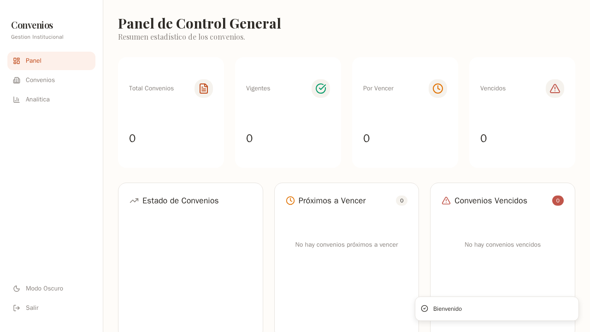
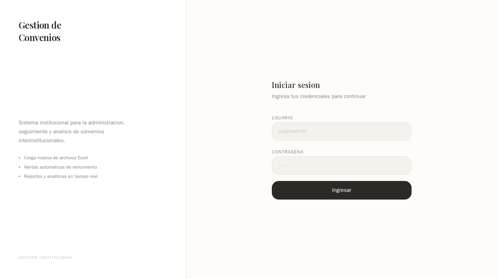
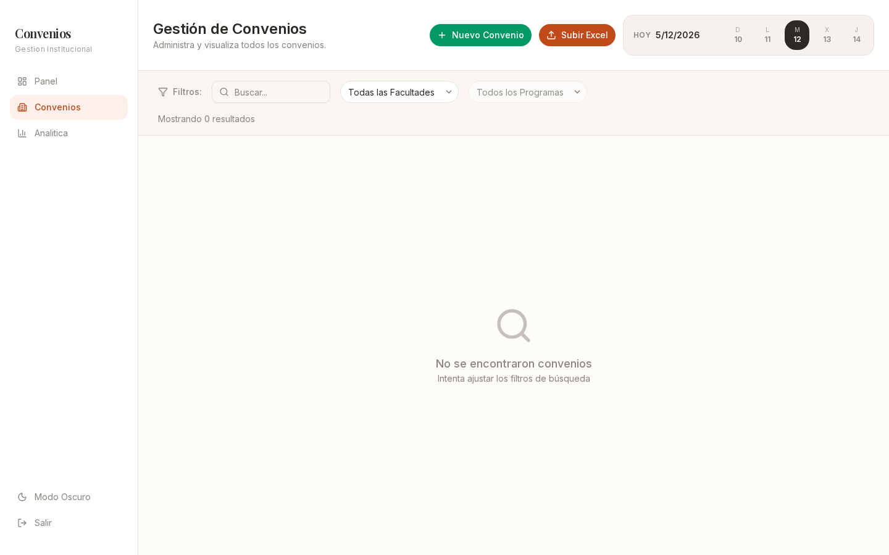
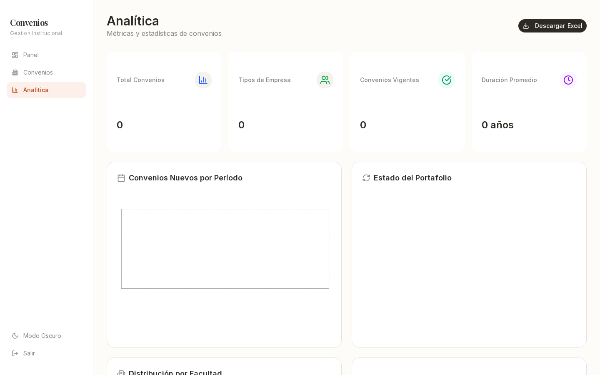

# Convenios — Institutional Agreement Management

Interface and design system for a private platform that manages inter-institutional
agreements at an educational institution. The application code belongs to the client; this
repository documents the product and its design decisions.

## Context

An educational institution manages hundreds of agreements with external organizations —
companies, city halls and universities. Tracking lived in separate spreadsheets, with no
consolidated view of upcoming expirations and no control over who could edit what.

The platform replaces that process with a single panel: bulk import from Excel, expiry
alerts, analytics by faculty and three access levels.

## What it does

- **Bulk import from Excel** — validates and inserts each record without manual entry
- **Expiry alerts** — KPIs for active, expiring and expired agreements, with visual warnings
- **Analytics** — distribution by faculty, status and time
- **Three access levels** — superadmin, supervisor and visitor, with granular permissions
- **Exports** — Excel, PDF and DOCX reports
- **Search and filters** — full-text search plus filters by faculty, status, organization and campus

## Screenshots

### Sign in

Split layout: institutional identity on the left, a minimal form on the right.

### Dashboard

Primary KPI, secondary metrics, distribution by status and a list of upcoming expirations.

### Agreement management

Table with search, multiple filters, drag-and-drop upload and per-agreement detail.

### Analytics

Distribution by faculty and status, plus a timeline.

## Design system

The interface follows the Kenya Hara / Muji line: visual calm, intentional emptiness, borders
instead of shadows and a single action color.

### Tokens

| Token | Value |
|---|---|
| Background | `#FEFCF9` — warm white |
| Text | `#2D2A26` — charcoal |
| Accent | `#C04A1A` — coral |
| Border | `#E6E2DD` — stone |
| Radius | `12px` |

### Typography

| Role | Typeface |
|---|---|
| Headings | Playfair Display |
| Body | Inter |
| Data | JetBrains Mono |

### Principles

- **Borders over shadows** — hierarchy without artificial elevation
- **One accent, not five** — coral is the only action color
- **Typography as identity** — Playfair Display carries the institutional tone without a logo
- **Intentional emptiness** — important information is given room to breathe
- **No decoration** — every element earns its place

## Stack

| Layer | Technology |
|---|---|
| Framework | Next.js 16 (App Router) |
| UI | React 19, Tailwind CSS v4, shadcn/ui |
| Data | PostgreSQL 14, Prisma, Zod |
| Charts | Recharts |
| Deployment | Cloudflare Tunnel + HTTPS |

## Scope of this repository

This repository is a showcase, not the application. It contains screenshots and
documentation for the design system; the code, database schema and credentials belong to
the client and are not published.

There is no public demo because the project is confidential. If you need a walkthrough of
the finished product, reach out through [my profile](https://github.com/c26200).
